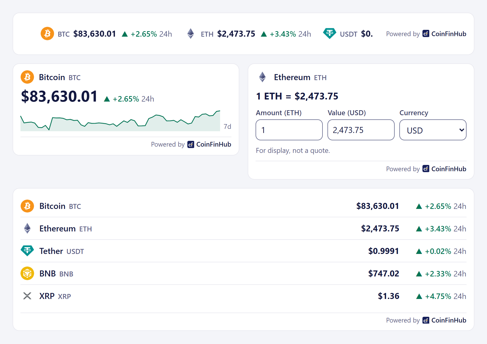
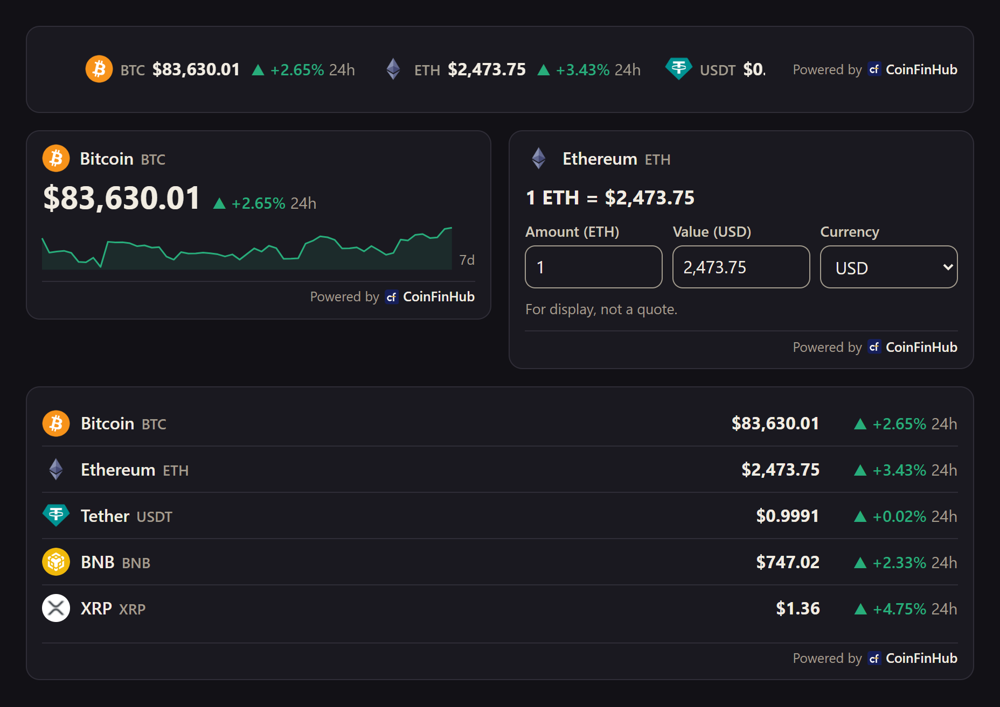

# CoinFinHub widgets

Four small widgets that show coin prices from [CoinFinHub](https://www.coinfinhub.com) on any website: a **price card**, a **list** (rows, or a headline strip), a **ticker** and a **converter**. One script defines all four, with no dependencies, in about 9 KB gzipped.

[Live demo](https://coinfinhub.github.io/coinfinhub-widget/) · [CoinFinHub](https://www.coinfinhub.com) · [MIT licence](LICENSE)

<!-- Screenshots arrive with v1.0.0: docs/screenshot-light.png and docs/screenshot-dark.png. -->

| Light | Dark |
|---|---|
|  |  |

## Quick start (30 seconds)

Add the script once per page, however many widgets it has:

```html
<script type="module" src="https://cdn.coinfinhub.com/widgets/1/coinfinhub-widget.js" crossorigin="anonymous"></script>
```

This is the latest 1.x: fixes and additions within version 1 reach your page without editing it. To pin one exact file instead, see [other addresses](#other-addresses-for-the-script).

Then put a widget where it should appear. Each one carries a plain link inside it, which shows instead when JavaScript is off or the browser is older than the ones below.

**Price card:** one coin's price and its 24-hour change, with the last 7 days as a line if you ask for it.

```html
<coinfinhub-price coin="bitcoin" chart="7d"><a href="https://www.coinfinhub.com/price/bitcoin" target="_blank" rel="noopener">CoinFinHub</a></coinfinhub-price>
```

**List:** the top coins, or the ones you name, in rows. `layout="strip"` puts them side by side as a headline strip, which wraps on narrow screens.

```html
<coinfinhub-list top="5"><a href="https://www.coinfinhub.com/" target="_blank" rel="noopener">CoinFinHub</a></coinfinhub-list>
<coinfinhub-list coins="bitcoin,ethereum,solana" layout="strip"><a href="https://www.coinfinhub.com/" target="_blank" rel="noopener">CoinFinHub</a></coinfinhub-list>
```

**Ticker:** a strip that moves sideways in a loop (the top 10 unless you say otherwise).

```html
<coinfinhub-ticker top="10"><a href="https://www.coinfinhub.com/" target="_blank" rel="noopener">CoinFinHub</a></coinfinhub-ticker>
```

**Converter:** "1 BTC = $86,091.97", with an amount of the coin and its value, both editable, and a currency picker.

```html
<coinfinhub-converter coin="bitcoin" currency="EUR"><a href="https://www.coinfinhub.com/price/bitcoin" target="_blank" rel="noopener">CoinFinHub</a></coinfinhub-converter>
```

- **Which coin:** the end of its page address on CoinFinHub, such as `bitcoin` in `https://www.coinfinhub.com/price/bitcoin`. Search for the coin on coinfinhub.com to find it.
- The [demo](https://coinfinhub.github.io/coinfinhub-widget/) has a builder that writes the snippet for you: pick the widget and coins, the currency, a width, the theme, a transparent background or no outline, and see it live.

### Other addresses for the script

- **One exact version, with an `integrity` hash.** The hash pins the file: if the file at that address ever changed, the browser would refuse to run it. Your page then doesn't take fixes by itself; to take one, change the version and the hash to the new release's:

  ```html
  <script type="module" src="https://cdn.coinfinhub.com/widgets/1.0.0/coinfinhub-widget.js" integrity="sha384-pQCKXy/X9/2BXLpMqSkkvkGXJeja4rME9pQSc3iUOpEpNDorXbJw3x8AFn5KRZ+7" crossorigin="anonymous"></script>
  ```

- **A mirror on jsDelivr**, the same file built from this repo's release tag, with the same hash:

  ```html
  <script type="module" src="https://cdn.jsdelivr.net/gh/coinfinhub/coinfinhub-widget@1.0.0/dist/coinfinhub-widget.js" integrity="sha384-pQCKXy/X9/2BXLpMqSkkvkGXJeja4rME9pQSc3iUOpEpNDorXbJw3x8AFn5KRZ+7" crossorigin="anonymous"></script>
  ```

## Attributes

| Attribute | Widgets | Values | Default |
|---|---|---|---|
| `coin` | price, converter | A coin's slug, such as `bitcoin`. Required. | |
| `coins` | list, ticker | Up to 20 slugs, comma-separated, such as `bitcoin,ethereum`. Shown in that order; used instead of `top`. | |
| `top` | list, ticker | `1` to `20`: CoinFinHub's top coins by rank. | `5` (list), `10` (ticker) |
| `layout` | list | `rows`, or `strip` for cells side by side | `rows` |
| `chart` | price | `none`, or `7d` for the 7-day line | `none` |
| `currency` | all | `USD` `EUR` `GBP` `JPY` `CNY` `INR` `AUD` `CHF`, in any case | `USD` |
| `theme` | all | `auto` follows the visitor's light or dark setting; `light` and `dark` fix it | `auto` |
| `width` | all | The widest it gets, in CSS pixels, such as `320`. At least 200 (ticker 240): a smaller number counts as that. Empty, `0` or no number fills the container. | fills the container |
| `background` | all | `transparent`: no surface, so your page shows through. | the widget's own surface |
| `border` | all | `none`: no outline around the widget. | outlined |
| `api` | all | The endpoint's base URL, for development and tests only. Leave it out. | `https://widgets.coinfinhub.com` |

Change `coin`, `coins`, `top`, `chart`, `currency` or `api` and the widget fetches again; `theme`, `layout`, `width`, `background` and `border` change only the look. The converter's picker sets its own `currency` attribute.

**With `background="transparent"`, pick the `theme` that matches your page** (`light` on a light page, `dark` on a dark one): the text and the up and down colours are made for their theme's surface, so on a background of the other kind they lose their contrast. `width` sets the widget's own maximum width inside its shadow root, so your page's styles still win if you set one.

## What they show

- **Every coin:** its logo (or the first letter of its symbol in a circle), name or symbol, price, and the 24-hour change as "▼ −1.34% 24h": arrow, sign and period always together, so colour is never the only signal. A change that rounds to 0.00% is flat: "• 0.00% 24h", in grey.
- **Prices** are written in the visitor's browser, as on CoinFinHub's own pages: two decimals from 1 up (none in yen), four decimals from 0.01 up to 1 ($0.4610), and four significant digits below 0.01 ($0.00000436), each chosen by the price once rounded (0.99995 is $1.00), with the currency's sign and a true minus.
- **A badge** for a coin with little trading ("Little trading": its price may be far from what you'd pay) or one that stopped trading ("No trades since 1 Oct 2026": the last price, with no change), so a page never shows a dead coin's old price as live.
- **The 7-day line** on the price card with `chart="7d"`: coloured by which way the week went, labelled "7d", and named for screen readers ("Price over 7 days, up").
- **The converter** works out either field from the other as the visitor types, from the price CoinFinHub sends. Commas, spaces and an empty field are fine. It is labelled "For display, not a quote".
- **The footer:** "Powered by CoinFinHub", linking to the coin's page (price card, converter) or CoinFinHub's home page (list, ticker). On its left, "Updated 4 min ago" when the prices are more than 3 minutes old, and "USD rate derived from ECB data" on prices in other currencies: "Updated 4 min ago · USD rate derived from ECB data".

Before the first answer a widget says "Loading prices…" (or "price…"). If a refresh fails, it keeps the last prices until they are 10 minutes old; then it says "Prices unavailable right now." A coin CoinFinHub doesn't know, a slug that isn't well-formed, or a coin whose answer can't be read is left out of a list; on a price card or converter it gets a message for you, the site's author. An answer the widgets don't know yet, such as a site that may no longer show CoinFinHub's prices, shows CoinFinHub's own message. The link stays in every state.

## Currencies

`USD` `EUR` `GBP` `JPY` `CNY` `INR` `AUD` `CHF`.

Prices are in US dollars first. CoinFinHub converts them with a dollar rate it derives from the European Central Bank's euro reference rates, and the widgets say so under the prices. If a currency's rate isn't available, a widget shows US-dollar prices, labelled "Shown in US dollars", and tries your currency again later. It never shows a price in the wrong currency. Rupees use lakh grouping (₹82,99,733.90).

## Size, look and fit

- About 9 KB gzipped for all four widgets (CI fails any build over 12 KB). No dependencies and no fonts; the only images are the coins' logos, from `cdn.coinfinhub.com`.
- Each widget fills its container from 200 px wide, or up to `width` if you give one. The layout adapts to its own width (container queries), not the window's.
- Text follows your page's text size and the visitor's zoom, but never goes below 15 px, even if your page shrinks its root font size. The converter's fields stay at 16 px or more, so phones don't zoom in on them.
- Each widget brings its own surface, border and colours (CoinFinHub's, light and dark), in Shadow DOM, so your page's styles don't leak in. It uses Inter if your page already loads it, otherwise the system font. There are no custom colours in v1.
- Only the ticker moves, at the same speed whatever its width or number of coins, repeating them as often as needed to fill the strip. It stops while the pointer is over it or it has focus, and for visitors who ask for reduced motion it stands still and scrolls sideways by hand.

## Accessibility

- Each widget is a group with a name ("Bitcoin price", "Coin prices"). Arrows are hidden from screen readers; the sign carries the direction.
- The ticker's second copy, which only makes the loop seamless, is hidden from screen readers and can't be focused. The ticker itself can be focused, to pause it, or to scroll it with the arrow keys when it stands still.
- The converter's fields have visible labels ("Amount (BTC)", "Value (USD)", "Currency") and a decimal keypad on phones.
- A 2 px focus ring. The link is at least 28 px tall (32 px on touch screens); the converter's fields are taller.
- Text is at least 4.5:1 against its background, and the up and down colours at least 4.77:1, in both themes.
- Refreshes are silent: nothing is announced every minute.
- Checked with axe in Chromium, Firefox and WebKit on every change.

## How they refresh

- Every 60 seconds plus up to 10 seconds of jitter, and only while the widget is on screen and the tab is visible.
- Widgets share requests. The widgets on a page refresh together, on one clock, and those that come on screen together ask in one call per currency (and 7-day line), up to 20 coins a call. Every ranked list (`top`) is cut from one call for the top 20, whose coins also answer for widgets that name them. Each coin is asked for at most once a minute, however many widgets show it and however often their attributes change.
- After a failed request a widget retries after 10 to 15 seconds, then backs off to 5 minutes, or waits as long as the server asks. A retry always reaches the server: failures aren't reused, unless the server asked to wait.
- When CoinFinHub is busy it may answer with prices up to a few minutes old. Prices more than 3 minutes old say so in the footer ("Updated 4 min ago"), worked out again on every refresh. The age goes by CoinFinHub's clock, sent with every answer, so a visitor's clock that is wrong doesn't change it.
- Requests are plain GETs with no cookies and no custom headers.

## Browser support

Chrome and Edge 111+, Firefox 115+, and Safari 16.4+ (macOS and iOS). Older browsers, and pages without JavaScript, show the plain link from the snippet.

## Content Security Policy

If your site sends a Content Security Policy, add these sources to your existing directives:

```
script-src https://cdn.coinfinhub.com;
connect-src https://widgets.coinfinhub.com;
img-src https://cdn.coinfinhub.com;
```

No `style-src` change and no `'unsafe-inline'` are needed: the styles come as a constructed stylesheet (`adoptedStyleSheets`), which a strict policy allows, and the ticker's speed is set through the CSS object model, which no policy blocks. A browser test runs the widgets under `default-src 'none'; script-src 'self'; style-src 'self'`. Without the `img-src` source, the logos are refused and each coin shows its letter instead. If you load the script from the jsDelivr mirror, `script-src https://cdn.jsdelivr.net` replaces the first source; if you host it yourself, `script-src 'self'`.

## Privacy for your visitors

- When a page shows a widget, the visitor's browser loads the script from `cdn.coinfinhub.com` (or the jsDelivr mirror, `cdn.jsdelivr.net`, or your own site if you host it), asks `widgets.coinfinhub.com` for the prices, and loads the coins' logos from `cdn.coinfinhub.com`.
- CoinFinHub's servers log those requests (IP address, time, browser, and the page that asked) for 14 days, for security and rate limits. In memory they count only which sites show the widgets. See the [CoinFinHub privacy policy](https://www.coinfinhub.com/privacy).
- No cookies are sent or set, nothing is stored on the visitor's device, and there is no fingerprinting or analytics on your page.
- Depending on where you are, you may need to name these hosts in your own privacy notice. Loading the script from jsDelivr adds it as a host of its own.
- The "Powered by CoinFinHub" link is a plain link (`rel="noopener"`) and opens in a new tab. It keeps the browser's normal referrer, which is how CoinFinHub sees which sites send visitors.

## Data terms

- The prices are for display, not for trading. Their use falls under "The CoinFinHub widgets" section of the [CoinFinHub Terms](https://www.coinfinhub.com/terms): any website, commercial ones included, may show them with the "Powered by CoinFinHub" link visible beside them. Don't hide or remove the link, collect the data in bulk, resell it, or use it for trading.
- There is no uptime promise. CoinFinHub may change or withdraw the widgets, or block a site.
- The price is the one CoinFinHub shows: the last trade on the coin's busiest up-to-date dollar market among the exchanges CoinFinHub reads. The choice of market and the 24h change are CoinFinHub's own. The data comes from third parties, and parts of it may be removed at a rights holder's request.

## Where the prices come from

The widgets read their own endpoint on widgets.coinfinhub.com. It belongs to the widgets: it is **not a public API**, it is rate-limited, and the Terms allow calling it only through the widgets. For a data API, [contact CoinFinHub](https://www.coinfinhub.com/contact).

## Hosting the script yourself

Copy `dist/coinfinhub-widget.js` from a release tag to your site and load it from there:

```html
<script type="module" src="/js/coinfinhub-widget.js"></script>
```

The widgets still ask `widgets.coinfinhub.com` for prices and load the logos from `cdn.coinfinhub.com`.

## Releases and security

Releases are git tags (`v1.0.0`), served from `cdn.coinfinhub.com/widgets/{version}/` and announced as [GitHub releases](https://github.com/coinfinhub/coinfinhub-widget/releases) and in the [changelog](CHANGELOG.md). The quick start's `/widgets/1/` follows the latest 1.x within about an hour. A pinned version never changes, so to take a fix there, update the version and the `integrity` hash in your snippet. To report a security problem, see [SECURITY.md](SECURITY.md).

## Development

See [CONTRIBUTING.md](CONTRIBUTING.md). In short: `npm ci`, then `npm run check`, and `npm run serve` for the demo on http://localhost:4173/.

## Licence

The code is [MIT-licensed](LICENSE), © 2026 Rudranx Digital Labs. The licence covers this code only: it gives no rights to the CoinFinHub name or logo, and the price data falls under the [CoinFinHub Terms](https://www.coinfinhub.com/terms), not under this licence.
